# GitHub Terrarium



**Design preview:** This fixed animated SVG sample uses synthetic data and is not generated from live GitHub activity.

A small living world shaped by your GitHub activity.
Stars bring flowers and fireflies, forks spread seedlings, pull requests grow plants, reviews enrich a pond, and issues add mushrooms.

**Status: public collection, persistent growth, and animated SVG rendering implemented.**
A paginated public collector, local growth-state reconciliation, read-only API probe, and offline checks are implemented.
The paper-cut SVG renderer, bounded ambient motion, and offline SVG validator are available as Python APIs, and offline `build`/`validate` commands produce and check the three-file output bundle, a low-level `publish` command pushes a validated bundle to the `output` branch, and `generate` connects collection, growth, building, and publication with one fresh recollection after a conflict; a development-only browser fixture gallery checks the images through HTML `img` elements, and the guarded daily workflow `generate.yml` runs `generate` on a schedule and on manual dispatch.
The first habitat was published by a manual bootstrap run on 2026-11-17, and a same-day replay reported `no-change`; see [publication verification](docs/notes/2026-11-17-publication-verification.md).
No scheduled run has been verified.

## Run the collection probe

Use Python 3.12 or later.
The package has no third-party runtime dependencies; Ruff and Playwright are pinned development-only tools.

```bash
python -m venv .venv
. .venv/bin/activate
python -m pip install --require-hashes -r requirements-dev.txt
python -m pip install -e .
python -m github_terrarium probe --repository AndrewDongminYoo/github-terrarium
```

Set `GH_TOKEN` or `GITHUB_TOKEN` in the environment; never put it in configuration or command arguments.
`terrarium.toml` contains the target login.
The repository argument may instead come from `GITHUB_REPOSITORY` in Actions.
`--day YYYY-MM-DD` selects a completed UTC day; the default is yesterday in UTC.
The probe reads at most one page of each connection and explicitly reports truncation.
Its sample counts are not complete statistics and must not be used for scoring.
It writes no growth state and never updates a remote branch.

```bash
python -m unittest discover -s tests -v
ruff check src tests tools
ruff format --check src tests tools
```

The read-only CI workflow runs these checks, an offline bundle regression (`python tools/ci_bundles.py`), and the fixture gallery in Chromium and WebKit on Linux; its triggers, credentials, and live-probe conditions are defined in the [GitHub Actions boundary](docs/specs/architecture.md#github-actions-boundary).
Hosted tests and public API access with the default workflow token passed in [Actions run 43690047131](https://github.com/AndrewDongminYoo/github-terrarium/actions/runs/43690047131) at `aaa3759`.
Daily review recovery was verified against existing public reviews; see [collection evidence](docs/notes/collection-verification.md).
Regenerate the development lock with `uv pip compile requirements-dev.in --generate-hashes -o requirements-dev.txt` after changing the input.

## Collect daily activity

```bash
python -m github_terrarium collect --repository AndrewDongminYoo/github-terrarium --start 2026-11-13 --end 2026-11-15 > snapshot.json
```

`--start` is inclusive, `--end` is exclusive and defaults to today in UTC.
A run accepts 1–90 completed days and prints a validated JSON snapshot only after every page succeeds.
Use `--expected-subject NODE_ID` when continuing an existing user's habitat.
The snapshot contains public repository stock counts and daily PR, issue, and review contribution counts, including empty days.
These are GitHub-recognized contributions, not an exhaustive record of every GitHub action.
Reviews count each PR once per UTC day; the generator repository, restricted/private records, and fork repositories' stock counts are excluded.
Popularity is observed on the actual collection date even when the activity interval is historical.
The collector allows at most 1,000 HTTP attempts, 100 pages per connection, three attempts per request, and a four-minute collection deadline.
Rate-limit waits above 30 seconds fail with no snapshot; rerun later.
Collection does not award growth or publish output.

## Reconcile local growth

The `grow` command is offline and prints a validated candidate state; it does not publish files or contact GitHub.
Bootstrap requires exactly 30 completed days ending on the snapshot's actual observation date.

```bash
python -m github_terrarium grow --snapshot tests/fixtures/pull-requests.json --bootstrap > state.json
python -m github_terrarium grow --snapshot tests/fixtures/pull-requests.json --state state.json > next-state.json
cmp state.json next-state.json
```

Use a separate destination from the input state so shell redirection cannot truncate the prior state.
Publishing a bootstrap additionally requires an absent remote output branch and an explicit `publish --bootstrap`; this local command alone does not authorize a remote reset.
For normal updates, collect from the earlier of today minus 30 days and the day after `last_complete_activity_day`, ending at today's UTC date exclusively.
The snapshot must cover exactly that interval, with no unknown days; an interval over 90 days requires explicit recovery.

Daily awards never decrease and reruns award only positive differences within the same daily caps.
Repository watermarks use immutable GitHub node IDs, not repository names: renames and disappearance/reappearance cannot copy star credit.
An unseen repository ID establishes its current baseline without an initial popularity award.
User login changes retain the same habitat identity; a different user ID fails.

For a longer gap, choose one fixed completed cutoff and collect contiguous batches of at most 90 days.
Start the first batch on the day after `last_complete_activity_day`; each next batch starts at the prior batch's exclusive end.
Pass `--recover-through YYYY-MM-DD` with that same cutoff to every `grow --state` call.
Persist each validated candidate separately before proceeding to the next batch.
Recovery retains existing popularity watermarks and observations without awarding historical popularity or using the batch's stock counts.
An unfinished recovery records its cutoff and blocks normal updates; after the final batch, perform a normal fresh collection to update popularity on its actual observation date.
The same explicit mode can apply deliberate older corrections within a snapshot of at most 90 days; do not include activity before this habitat's bootstrap.

State files are UTF-8 JSON, limited to 2 MiB, and reject duplicate keys, unsupported versions, missing dates, invalid counts, and inconsistent derived activity totals.
The five synthetic fixtures cover empty, popularity-heavy, PR-heavy, review-heavy, and issue-heavy histories.
See [growth verification](docs/notes/growth-verification.md) for the checked invariants and local review results.

## Render a habitat

The `render(state)` Python API accepts a validated growth state and returns deterministic UTF-8 SVG bytes.
It reuses the existing stages and normalized traits, with stable subject-ID-based anchors and bounded object slots.
Embedded CSS adds leaf sway, firefly travel, and pond ripples; after seven completed UTC days with no eligible PR, review, or issue activity, motion becomes calmer without changing earned growth or geometry.
Reduced motion disables every ambient animation and transition, and disabled CSS leaves the complete static scene visible.
The `build` command below renders through this API, and `publish` pushes the resulting bundle.

```bash
python - <<'PYTHON'
from pathlib import Path
from github_terrarium.growth import advance
from github_terrarium.render import render
from github_terrarium.state import read_json

state = advance(read_json("tests/fixtures/pull-requests.json"))
Path("terrarium-preview.svg").write_bytes(render(state))
PYTHON
```

The container-free scene assembles packaged [paper-cut SVG pieces](assets/terrarium/papercut.svg) derived from the preserved design reference; their [provenance and extraction command](assets/terrarium/README.md) are recorded with the source.
Earned growth expands the tree and roots through five stages; recent activity fills bounded canopy, branch, seedling, flower, firefly, pond, mushroom, and ground-cover slots.
The fixed banner above previews the reference artwork; it is separate from generated renderer output.
The renderer alone does not establish full browser compatibility or approval of its generated scenes; those remain gallery and operator-review gates.
See [paper-cut port verification](docs/notes/papercut-renderer-verification.md) for the checked scope and remaining limits.
See [motion verification](docs/notes/motion-verification.md) for the tested fallback behavior and reduced-motion browser setup.

## Validate a rendered SVG

`validate_svg(raw)` accepts current generator-format UTF-8 SVG bytes and returns `None`, or raises `ValueError` without rewriting the image.
It checks XML, the closed element/attribute/CSS vocabulary, typed internal references, finite geometry, structural identity/date metadata, and the 200 KiB / 1,200-element / 40-animation limits.
DTD/entities, processing instructions, external resources, reference cycles and excessive nesting/reuse are rejected offline.
Only the renderer's exact ambient stylesheet or complete CSS absence is supported; arbitrary SVG/CSS is outside this API.

```bash
python - <<'PYTHON'
from github_terrarium.validate import MAX_BYTES, validate_svg

with open("terrarium-preview.svg", "rb") as stream:
    validate_svg(stream.read(MAX_BYTES + 1))
PYTHON
```

Call this API explicitly; `render` does not invoke it automatically.
See [SVG validation verification](docs/notes/svg-validation-verification.md) for negative-fixture coverage and limits.

## Check the fixture gallery in browsers

The gallery embeds every fixture SVG through HTML `img` elements: the five personas, every growth stage, a fully saturated Sanctuary, a renamed user, and a calm inactive habitat, all grown with the existing growth engine.

```bash
python -m playwright install chromium webkit
python tools/gallery.py build
python tools/gallery.py check
```

`build` is offline and writes `work/gallery/index.html`, the SVGs, and measurements; open the page in any browser to review the scenes.
`check` runs Chromium and then WebKit at 360/768/900 CSS pixels, on light and dark host backgrounds, with normal and reduced motion, and fails on horizontal overflow, clipping, missing motion, moving text, or reduced-motion changes.
It also runs deliberate overflow, clipping, missing-motion and ignored-reduced-motion controls and fails if any of them passes.
Captures and `results-<engine>.json` stay in the ignored `work/gallery/` directory, and every browser it opens is closed.
Unit tests cover the browser-free parts; the browser checks run only through this command.
See [fixture gallery verification](docs/notes/fixture-gallery-verification.md) for engine versions, results, measurements and pending cells; visual approval remains a separate review.

## Build and validate an output bundle

`build` is offline: it reconciles growth from a snapshot, renders and validates the SVG, and writes `terrarium.svg`, `state.json`, and `manifest.json` to a bundle directory.
It prints the manifest on success; a data or validation failure exits 1 with no stdout and leaves the destination and inputs unchanged, and usage errors exit 2.

```bash
python -m github_terrarium build --snapshot tests/fixtures/pull-requests.json --bootstrap --bundle-dir bundle --source-commit "$(git rev-parse HEAD)"
python -m github_terrarium validate --bundle-dir bundle
```

For an update, pass `--state` with the prior `state.json` instead of `--bootstrap`; the same directory may be the destination.
`--bootstrap` refuses a directory that already holds any bundle file.
An update into a directory that holds a bundle requires that bundle to be valid, for the same user, and to contain exactly the supplied prior state, so a stale `--state` copy cannot replace newer growth.
Other files in the directory are never touched.
`validate` checks the three files without modifying them.
The [technical design](docs/specs/architecture.md#atomic-publication) defines the manifest keys and the validation rules.

## Publish a bundle

`publish` revalidates a bundle and pushes it to the `output` branch with one commit whose parent is the expected remote head; the push is leased on that head, so it fast-forwards or fails as a conflict and never rewrites history.

```bash
python -m github_terrarium publish --bundle-dir bundle --repository AndrewDongminYoo/github-terrarium --expected-parent absent --bootstrap
python -m github_terrarium publish --bundle-dir bundle --repository AndrewDongminYoo/github-terrarium --expected-parent "$(git ls-remote https://github.com/AndrewDongminYoo/github-terrarium.git refs/heads/output | cut -f1)"
```

It builds the commit in a temporary bare Git directory, so the current checkout's branch, index, worktree, and configuration are never read or changed.
Only `terrarium.svg`, `state.json`, and `manifest.json` change; every other path on `output` is preserved, and extra files in the bundle directory are ignored.
A new root commit requires both `--expected-parent absent` and `--bootstrap`, and `--bootstrap` fails when the branch exists.
An existing branch must hold a valid bundle for the same subject, and the candidate's activity and popularity dates must not move backwards; a candidate with an unfinished recovery cutoff is refused.
When all three files are byte-identical to the parent, nothing is pushed and the result reports `no-change`.
After a push, a fresh fetch must show the new commit as the remote head with matching file hashes before `published` is reported.
The token comes only from `GH_TOKEN` or `GITHUB_TOKEN` and reaches Git through environment-scoped configuration, never through arguments, remote URLs, or commits; `--remote URL` overrides the default `https://github.com/OWNER/NAME.git` for local tests.
Success prints a canonical JSON result; failures exit 1 with no stdout, a remote head that differs from the expected parent or a rejected push exits 3, and usage errors exit 2.
A failed readback after a successful push exits 1 and names the pushed commit.
`generate` below fetches fresh data and retries once after a conflict.

## Generate and publish

`generate` reads the current `output` head and bundle, collects the interval that state requires, grows the state, builds and validates the bundle, and publishes it over the head it read.

```bash
GH_TOKEN=... python -m github_terrarium generate --config terrarium.toml --repository AndrewDongminYoo/github-terrarium --source-commit "$(git rev-parse HEAD)" --bootstrap
GH_TOKEN=... python -m github_terrarium generate --config terrarium.toml --repository AndrewDongminYoo/github-terrarium --source-commit "$(git rev-parse HEAD)"
```

`--bootstrap` is accepted only while the `output` branch is absent; an existing branch without a valid bundle fails and is never reset.
An update collects the last 30 completed UTC days plus any missed days; a gap over 90 days or an unfinished recovery fails before collection and needs `grow --recover-through` batches.
If another publisher moves the head first, the run discards its snapshot, reads the new head, collects again, and retries once; a second conflict exits 3 and leaves the newer output untouched.
`--source-commit` defaults to `GITHUB_SHA`, and `--remote URL` works as for `publish`.
Success prints one JSON summary with the activity interval, stock date, recovered gap days, XP delta, file sizes, attempts, commit, and `published` or `no-change`; failures print one error line to stderr and nothing to stdout.
`--summary PATH` also appends a Markdown summary of the result or the failure to `PATH`, as the workflow does with `GITHUB_STEP_SUMMARY`; if `PATH` cannot be written, the exit code is unchanged and stderr gets one more `warning: summary not written:` line, after a success too.

## Daily workflow

[`generate.yml`](.github/workflows/generate.yml) runs `generate` at 00:23 UTC each day (09:23 Asia/Seoul) and on manual dispatch from the default branch; the [GitHub Actions boundary](docs/specs/architecture.md#github-actions-boundary) defines its triggers, permissions, and guards.

- **Enabling:** the schedule is active once the workflow is on the default branch. Scheduled runs fail with "Output branch is absent" until one manual run creates the habitat (Actions → Daily generation → Run workflow on the default branch, with `bootstrap` checked); that bootstrap ran on 2026-11-17, so `output` now exists.
- **Manual reruns:** run the workflow again with `bootstrap` unchecked. The manifest records the source commit, so a rerun reports `no-change` and pushes nothing only when it collects nothing new and the default branch has not moved since the last publication; otherwise it publishes a new `output` commit. A dispatch from another branch skips the job.
- **Token:** the job uses only the repository `GITHUB_TOKEN` with `contents: write`; no personal token or secret is needed, and none is created or rotated.
- **Output URLs:** after the bootstrap, the image is `https://raw.githubusercontent.com/AndrewDongminYoo/github-terrarium/output/terrarium.svg`, next to `state.json` and `manifest.json` on the [`output` branch](https://github.com/AndrewDongminYoo/github-terrarium/tree/output).
- **Delays and disablement:** GitHub can start scheduled runs late or drop them, and disables schedules in a public repository after 60 days without repository activity; re-enable the workflow on the Actions page. A missed day is collected by the next run, and a delay is not inactivity.
- **Failures and recovery:** read the job summary; a failed run leaves the last valid habitat unchanged. A gap over 90 days or an unfinished recovery needs `grow --recover-through` batches, and the workflow never resets or bootstraps over an existing branch.

## Planned experience

- A personal terrarium with a stable layout that grows over time.
- Public GitHub activity mapped to five visual traits and persistent growth.
- Gentle SVG animation that plays inside a GitHub profile README without JavaScript.
- Daily GitHub Actions generation, with images and growth state committed together to an `output` branch.
- A calm resting state during inactivity, with no loss of earned growth.

## Documentation

| Document | Contents |
| --- | --- |
| [Product specification](docs/specs/terrarium.md) | Scope, metric definitions, visual behavior, scoring, and acceptance criteria |
| [Technical design](docs/specs/architecture.md) | Collection, persistent state, SVG rendering, daily publication, and failure recovery |
| [Implementation plan](docs/plans/implementation.md) | Ordered milestones, intended files, tests, and release gates |
| [Contribution guide](CONTRIBUTING.md) | Current workflow and project boundaries |

## Repository layout

```plaintext
main
├── AGENTS.md
├── CONTRIBUTING.md
├── README.md
├── pyproject.toml
├── terrarium.toml
├── assets/
│   ├── references/   # unchanged design reference
│   └── terrarium/    # packaged SVG pieces (github_terrarium.art)
├── docs/
│   ├── notes/        # dated verification evidence
│   ├── plans/
│   └── specs/
├── src/github_terrarium/
├── tests/
└── tools/            # asset extraction, the bundle regression, and the browser fixture gallery
```

The `output` branch contains `terrarium.svg`, `state.json`, and `manifest.json` at its root.
The first validated bootstrap publication created it on 2026-11-17.
The daily schedule is 00:23 UTC (09:23 Asia/Seoul), subject to GitHub scheduling delays.

## License

Source code and original artwork are released under the [MIT License](LICENSE).
Artwork provenance is recorded in [the asset notes](assets/terrarium/README.md).
