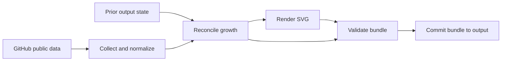

# GitHub Terrarium Technical Design

Status: v1 design; a read-only capability probe exists, while the full pipeline remains planned.
Decision date: 2026-11-15.
The [product specification](terrarium.md) owns behavior and scoring constants.

## Architecture

Use a single Python command-line application with separate collection, normalization, growth, rendering, validation, and publication modules.
Target Python 3.12 initially to match the predecessor's declared runtime.
Prefer standard-library HTTP, JSON, TOML, XML, hashing, and unit-test facilities for the first serial, single-user collector.
Add a runtime dependency only when a demonstrated requirement justifies it; pin and lock it in the same change.
No web server, queue, general plugin system, or runtime database is needed.



Only the collector performs API reads; only the publisher performs remote writes.
Scoring and rendering are pure functions of explicit inputs.
Read output data as untrusted structured data; never import code or execute scripts from the output branch.

## Planned source layout

```plaintext
main/
├── pyproject.toml
├── terrarium.toml
├── src/github_terrarium/
│   ├── __main__.py
│   ├── config.py
│   ├── github.py
│   ├── models.py
│   ├── normalize.py
│   ├── growth.py
│   ├── state.py
│   ├── render.py
│   ├── validate.py
│   └── publish.py
├── assets/terrarium/
├── tests/fixtures/
└── .github/workflows/
    ├── ci.yml
    └── generate.yml

output/
├── terrarium.svg
├── state.json
└── manifest.json
```

These are future paths, not files supplied by the documentation bootstrap.
Keep output files at the branch root so the embedding URL remains stable.
Do not implement a configurable output branch in v1; use `output` consistently.

## Configuration and commands

`terrarium.toml` contains the target login; the workflow obtains the generator repository identity from `GITHUB_REPOSITORY` for exclusion and publication.
Require an explicit repository identity for local live collection and never infer it from an unrelated working directory.
Version scoring constants and visual defaults in source rather than exposing arbitrary formulas in configuration.
Use a stable SHA-256-derived seed from the subject node ID plus a fixed seed-version string; do not use Python's randomized `hash()`.

The implemented diagnostic command is `python -m github_terrarium probe`; it returns first-page sample counts, explicit truncation flags, and `complete_snapshot: false`.
It does not produce a normalized growth snapshot or write state.
Planned pipeline commands are `collect`, `build`, `validate`, and `publish` under `python -m github_terrarium`.
`collect` produces a normalized snapshot in a temporary directory, `build` reads that snapshot and prior state, `validate` inspects the complete bundle, and `publish` requires the expected remote parent SHA.
An explicit `--bootstrap` is valid only when the remote output branch does not exist.
Offline builds require an explicit fixture date and never contact GitHub.
Routine runs use the current UTC date; historical recovery must not fabricate past popularity snapshots.
Freeze detailed CLI flags and errors in milestone 1 and update examples with the implemented interface.

## Collection and normalization

Resolve `user(login)` to an immutable node ID and reject a mismatch with existing state.
Enumerate all owned public, non-fork repositories with cursor pagination, including archived originals and excluding the generator repository by immutable repository ID.
Read `stargazerCount` and `forkCount` for the eligible set.
Use stable node IDs for watermarks so repository renames do not create new credit.

Query PR-opening and issue-opening contribution collections in bounded windows of at most 30 days.
Query reviews separately for each completed UTC day: the review contribution connection returns the most recent review per PR, so a multi-day query cannot establish all daily review units.
Page through every connection rather than trusting unfiltered totals.
Inspect repository visibility on every eligible record; exclude restricted/private records deliberately and fail on unexpected missing required fields.
Use `occurredAt` for UTC day bucketing, PR/issue node IDs for duplicate removal, and `(subject ID, PR ID, UTC day)` for review units.
For reviews, select the contribution's `pullRequest`, `pullRequestReview`, and `repository` fields; do not count inline comments as additional reviews.
Include PR-opening contributions regardless of current draft or merge state; merge bonuses require a later, separate event definition.

Use half-open internal intervals `[start, end)` and explicitly filter returned timestamps, even when the upstream query has inclusive endpoints.
Never use GitHub's recent-events feed as an exhaustive activity ledger.
Count only GitHub-recognized contributions visible through the chosen public collection contract; document that these are not all possible GitHub actions.

HTTP success is insufficient: reject GraphQL `errors`, incomplete connections, cursor loops, missing fields, and inconsistent subject IDs.
Use request deadlines, bounded retry with jitter for retryable failures, and rate-limit reset/retry headers.
Fail after the bounded collection budget rather than publish partial numbers; distinguish authentication, permission, rate limit, transport, and malformed-response errors.
The first integration spike must test public collection with an actual Actions `GITHUB_TOKEN` against the configured user.
The daily-review-query assumption is `[UNKNOWN]` until a public PR with reviews by the same user on two different UTC days is checked using the two daily queries.
Use existing public events, not artificial reviews, for that read-only check; if the required records are not recoverable, revise the review collector contract before milestone 2 rather than claim complete daily counts.
An optional read credential may be introduced only if that verified path is insufficient; the public-data filter remains mandatory.

## Logical time and replay

Let `D` be the UTC date of collection.
Activity is complete only through `D - 1`; exclude the open day `D` from activity growth and the 30-day activity traits.
Popularity is a stock observation made on `D`, so its changes belong to observation day `D`, not automatically to `D - 1`.
The SVG freshness label names the last complete activity date; the manifest also records the popularity observation date.

Bootstrap reads 30 completed activity days and establishes all current repository watermarks.
For subsequent runs, collect the earlier of `D - 30 days` and the day after the previous complete activity day, through `D` exclusive.
This refreshes the 30-day window and recovers missed activity without counting events twice.
Recompute recent daily counts, then award only the positive difference from the day's already awarded activity XP.
If a day's corrected count falls, retain awarded XP while updating recent-trait counts to the observed value.
Corrections outside the refreshed window are not automatically recovered; historical correction is a deliberate maintenance operation.

Bound an automatic recovery to 90 activity days in a run, split into PR/issue query windows of at most 30 days and individual UTC-day review queries.
A larger gap fails with a recovery instruction and preserves the prior bundle.
Implement deliberate recovery as sequential, validated batches against a fixed final cutoff; historical batches do not update popularity.
For a gap in popularity observations, only net increases above the last high-water marks are known; credit those on the actual observation day and do not invent a daily distribution.

## Persistent state contract

Use UTF-8 JSON with a versioned schema, sorted object keys, integer counts, bounded strings, and finite numeric values.
Do not accept unknown future schema or scoring versions without an explicit migration.

| Field | Meaning and invariant |
| --- | --- |
| `schema_version` | Version of the persisted shape; initially 1 |
| `scoring_version` | Version of weights, caps, and credit rules; initially 1 |
| `subject` | Node ID, current login, and seed version; node ID is immutable |
| `last_complete_activity_day` | Last day covered by complete activity collection |
| `last_popularity_observation_day` | UTC day of the last validated stock observation |
| `days` | Date-keyed daily counts, accumulated observed popularity units, and awarded XP |
| `repository_watermarks` | Per-public-repository node ID, maximum observed stars and forks |
| `current_traits` | Current eligible stock totals and recomputed 30-day activity totals |

Each daily record contains `prs`, `reviews`, `issues`, `new_star_units`, `new_fork_units`, `activity_xp_awarded`, and `popularity_xp_awarded`.
An omitted activity record is unknown; an explicitly recorded zero day is known empty.
Popularity-only day `D` must mark activity counts as `null` until that day is collected as complete.
Derive total growth from the sum of awarded fields rather than maintaining a second mutable counter.
For popularity, accumulate positive differences above each repository's watermark within observation day `D`, then compute the positive difference from that day's existing capped award.
Update the watermark to the maximum of previous and current counts, never downward.
Keep watermarks for repositories that disappear from the eligible set so reappearance does not reset their credit baseline.
Newly observed repository IDs establish a baseline without immediate popularity XP.

Retain daily aggregate records and watermarks in v1; impose a 2 MiB state-file validation limit and stop with a migration requirement if exceeded.
Do not silently prune records or lose awards to satisfy a size limit.
Commit only public aggregate counts and public repository identifiers; raw GraphQL payloads, titles, bodies, review text, and credentials stay out of `output`.
Discard raw collection payloads after the run and summarize errors without sensitive response dumps.
Validate the subject, date continuity, nonnegative integer counts, null-day rules, XP bounds, and state-size limit before use and again before publication.

## Rendering contract

Render SVG primitives, groups, paths, gradients, clip paths, and internal reusable symbols.
Use native SVG for v1 rather than `foreignObject`; do not include scripts, remote fonts, external images, event handlers, or embedded HTML.
Escape all text and attribute content and allow only expected internal fragment references.
Keep CSS inside the SVG and limit the initial animation vocabulary to transforms and opacity.
Use a static base pose so disabled CSS animation cannot hide the illustration.
Reduced-motion CSS disables every ambient animation without changing the habitat's data-driven state.

Use stable named anchors and independent seeded choices per feature; adding one plant must not reshuffle the pond or existing plants.
Map visual traits to bounded object slots and prioritize silhouette over tiny detail at 360 CSS pixels.
Validate the scene on light/dark host backgrounds despite its opaque scene canvas.
Treat 200 KiB, 1,200 elements, and 40 animated groups as initial acceptance budgets; record browser performance separately rather than promising a frame rate from these counts.
The validator must fail malicious or malformed SVG fixtures, not merely parse a known-good image.

## Atomic publication

Keep generation code on the default branch; the output branch contains data and presentation artifacts.
Fetch and record the current `output` head before collection and building.
Reject snapshots whose complete-activity or popularity-observation dates precede the corresponding dates already recorded in state; explicit historical activity recovery leaves popularity untouched.
If the branch is absent, use a new root commit; if it exists without valid state, fail instead of bootstrapping.
Construct publication in a separate temporary Git directory or with Git plumbing so source checkout contents and untracked work cannot be staged accidentally.
Update only the three owned output paths and preserve unrelated existing paths; never stage the whole source tree.

`manifest.json` records the subject ID, logical dates, schema/scoring/renderer versions, source commit, and SHA-256 hashes of `state.json` and `terrarium.svg`.
Do not embed the output commit's own SHA or a wall-clock generation timestamp in its contents.
Serialize the same logical inputs identically; byte-identical bundles produce no commit.
Commit all three files together and perform an ordinary, non-forced push whose parent is the fetched output head.

Use workflow concurrency group `terrarium-output` with cancellation disabled to serialize automated publishers.
A concurrent external update may still reject a push: fetch the new head, discard the old collection snapshot, collect fresh data against the new state's required interval, revalidate and rebuild, then retry once.
Recollection is required even when both publishers ran on the same UTC day, because day labels alone cannot order their observations.
Never transplant a state delta or overwrite a newer head; a second rejection fails with the previous remote bundle intact.
Read back the remote commit and manifest hashes after a successful push before reporting publication success.

## GitHub Actions boundary

The planned generation workflow has `schedule` and `workflow_dispatch` triggers only and runs trusted default-branch code.
Reject manual dispatch from another ref for the publication job.
Use job-level `contents: write` only for generation/publication; CI uses read-only permissions and no data secrets.
Do not run publishing through `pull_request_target` or execute contributor-controlled artifacts with a write token.
Do not add a push trigger for `output`, and do not depend on bot-commit trigger suppression to prevent a loop.
Pin third-party actions to verified full commit SHAs at implementation time; do not copy stale version assumptions from this document.

The workflow summary reports subject, collection window, whether a gap was recovered, awarded growth, byte size, and publication/no-change/failure status.
Schedule delays or disabled workflows are operational states, not evidence of inactivity.
Document GitHub's public-repository inactivity disablement and manual reactivation; do not assume generated commits permanently prevent disablement.
Never create or rotate a personal token automatically.

## Verification and recovery

Unit tests cover normalization, daily credit reconciliation, watermarks, version validation, deterministic serialization, and XML escaping.
Fixture tests cover empty, highly active, popularity-heavy, review-heavy, renamed-user, private-record, partial-response, delayed-run, and stale-state cases, including the same PR reviewed on multiple days.
Publisher tests use local bare remotes to prove atomic commits, clean no-ops, missing-state refusal, concurrent changes, rejected pushes, and preserved unrelated paths.
Browser tests embed the SVG through an HTML `img`; opening the SVG document directly is insufficient.
Capture normal and reduced-motion states, narrow layouts, and at least two time-separated frames; perform a final GitHub README smoke test before release.

Recovery restores a verified prior state through a new output commit, never by rewriting branch history.
Unsupported schema/scoring changes require an explicit migration plan and fixture proof before rollout.
An intentional new-user reset is outside routine generation and requires retaining the old output history.

## Evidence and design provenance

The operator requested a new personal repository, plans/specs documentation, five activity dimensions, and daily branch publication on 2026-11-15.
The following primary sources informed this design; the new project reuses no predecessor code or artwork in this bootstrap.

1. [Personal predecessor workflow](https://github.com/AndrewDongminYoo/github-stats-transparent/blob/main/.github/workflows/main.yml): confirms the Python/Actions/SVG publication pattern; its force-push publication is intentionally not carried into persistent growth.
2. GitHub documentation: [user contribution fields](https://docs.github.com/en/graphql/reference/users), [repository counts](https://docs.github.com/en/graphql/reference/repos), [scheduled workflow behavior](https://docs.github.com/en/actions/reference/workflows-and-actions/events-that-trigger-workflows#schedule), and [workflow token permissions](https://docs.github.com/en/actions/tutorials/authenticate-with-github_token), accessed 2026-11-15.
3. [W3C secure animated SVG mode](https://www.w3.org/TR/SVG/latest/conform.html#secure-animated-mode): supports timed animation in image contexts while restricting script execution, interaction, and external resources.
