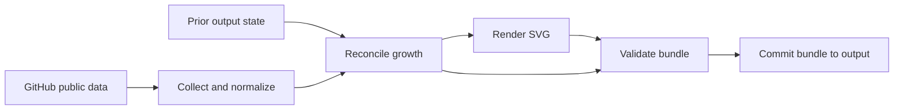

# GitHub Terrarium Technical Design

Status: v1 design; public collection, persistent growth, ambient SVG rendering, SVG validation, offline bundle build/validation, output publication, the `generate` orchestration with one conflict recollection, and the `restore` maintenance command are implemented, and the `generate.yml` workflow runs on its daily schedule.
Decision date: 2026-11-15.
The [product specification](terrarium.md) owns behavior and scoring constants.

## Architecture

Use a single Python command-line application with separate collection, normalization, growth, rendering, validation, and publication modules.
Target Python 3.12 initially to match the predecessor's declared runtime.
Prefer standard-library HTTP, JSON, TOML, XML, hashing, and unit-test facilities for the first serial, single-user collector.
Add a runtime dependency only when a demonstrated requirement justifies it; pin and lock it in the same change.
No web server, queue, general plugin system, or runtime database is needed.



Only the collector performs API reads; only the publisher performs remote writes.
Scoring and rendering are pure functions of explicit inputs.
Read output data as untrusted structured data; never import code or execute scripts from the output branch.

## Source layout

```plaintext
main/
├── pyproject.toml
├── terrarium.toml
├── tools/
│   ├── ci_bundles.py
│   ├── extract_papercut_assets.py
│   └── gallery.py
├── src/github_terrarium/
│   ├── __main__.py
│   ├── config.py
│   ├── github.py
│   ├── models.py
│   ├── probe.py
│   ├── normalize.py
│   ├── growth.py
│   ├── state.py
│   ├── render.py
│   ├── validate.py
│   ├── bundle.py
│   ├── publish.py
│   └── generate.py
├── assets/references/
├── assets/terrarium/
├── tests/fixtures/
└── .github/workflows/
    ├── ci.yml
    └── generate.yml

output/
├── terrarium.svg
├── state.json
└── manifest.json
```

Every source path above exists, and the first bootstrap created the live `output` branch on 2026-11-17.
Keep output files at the branch root so the embedding URL remains stable.
Do not implement a configurable output branch in v1; use `output` consistently.

## Configuration and commands

`terrarium.toml` contains the target login; the workflow obtains the generator repository identity from `GITHUB_REPOSITORY` for exclusion and publication.
Require an explicit repository identity for local live collection and never infer it from an unrelated working directory.
Version scoring constants and visual defaults in source rather than exposing arbitrary formulas in configuration.
Use a stable SHA-256-derived seed from the subject node ID plus a fixed seed-version string; do not use Python's randomized `hash()`.

The implemented diagnostic command is `python -m github_terrarium probe`; it returns first-page sample counts, explicit truncation flags, and `complete_snapshot: false`.
It does not produce a normalized growth snapshot or write state.
The implemented `collect --start DATE [--end DATE] [--expected-subject ID]` command emits a validated snapshot to stdout, with the same configuration/repository flags as `probe`.
It observes stock on the UTC date read before the first request and reads the clock again when collection finishes; when the date has changed, it exits 1 with a rerun instruction and prints no snapshot, so stock read after UTC midnight is never filed under the earlier day.
A caller that passes its own observation day to the `collect()` API owns that check, as `generate` does.
The offline `build --snapshot FILE (--state FILE | --bootstrap) --bundle-dir DIR --source-commit SHA` command reconciles growth, writes a validated three-file bundle, and prints its manifest; `validate --bundle-dir DIR` re-checks an existing bundle and prints its manifest.
The `publish --bundle-dir DIR --repository OWNER/NAME --expected-parent SHA|absent [--bootstrap] [--remote URL]` command publishes a validated bundle; `absent` requires `--bootstrap` and `--bootstrap` requires `absent`.
The caller can save `collect` output to a temporary file; `build` reads that snapshot and prior state.
The local `grow --bootstrap` command requires exactly 30 completed days and no supplied prior state.
`publish --bootstrap` additionally proves the remote output branch does not exist; a failed branch lookup is a failure, not an absent branch.
Offline builds require an explicit fixture date and never contact GitHub.
Routine runs use the current UTC date; historical recovery must not fabricate past popularity snapshots.
Failures return exit status 1 with sanitized diagnostics; usage errors return 2; a publish or restore conflict returns 3.
The offline `grow --snapshot FILE` command requires either `--state FILE` or `--bootstrap`, accepts optional `--recover-through DATE`, and prints a validated candidate state.
`--remote` overrides the default `https://github.com/OWNER/NAME.git` remote for local bare-remote tests.
The online `generate --config FILE --repository OWNER/NAME [--bootstrap] [--source-commit SHA] [--remote URL]` command connects collection, growth, bundle building, and publication; `--source-commit` defaults to `GITHUB_SHA`, and a missing or non-canonical SHA is a usage error.
The token comes only from `GH_TOKEN` or `GITHUB_TOKEN`, and the output branch is always `output`.
The maintenance `restore --repository OWNER/NAME --from-commit SHA --expected-parent SHA [--remote URL]` command restores a historical output bundle; both SHAs must be full lowercase 40-character SHAs, and `absent` is a usage error.

## Collection and normalization

Resolve `user(login)` to an immutable node ID and reject a mismatch with existing state.
Enumerate all owned public, non-fork repositories with cursor pagination, including archived originals and excluding the generator repository by immutable repository ID.
Read `stargazerCount` and `forkCount` for the eligible set.
Use stable node IDs for watermarks so repository renames do not create new credit.
Repository names are not stored as watermark keys; unseen IDs establish a baseline rather than importing their existing stars as growth.

Query PR-opening and issue-opening contribution collections in bounded windows of at most 30 days.
Query reviews separately for each completed UTC day: the review contribution connection returns the most recent review per PR, so a multi-day query cannot establish all daily review units.
Page through every connection rather than trusting unfiltered totals.
Inspect repository visibility on every eligible record; exclude restricted/private records deliberately and fail on unexpected missing required fields.
Use `occurredAt` for UTC day bucketing, PR/issue node IDs for duplicate removal, and `(subject ID, PR ID, UTC day)` for review units.
For reviews, select the contribution's `pullRequest`, `occurredAt`, and `repository` fields; do not count inline comments as additional reviews.
Include PR-opening contributions regardless of current draft or merge state; merge bonuses require a later, separate event definition.

Use half-open internal intervals `[start, end)` and explicitly filter returned timestamps, even when the upstream query has inclusive endpoints.
Never use GitHub's recent-events feed as an exhaustive activity ledger.
Count only GitHub-recognized contributions visible through the chosen public collection contract; document that these are not all possible GitHub actions.

HTTP success is insufficient: reject GraphQL `errors`, incomplete connections, cursor loops, missing fields, and inconsistent subject IDs.
Use request deadlines, bounded retry with jitter for retryable failures, and rate-limit reset/retry headers.
Fail after the bounded collection budget rather than publish partial numbers; distinguish authentication, permission, rate limit, transport, and malformed-response errors.
The first integration spike must test public collection with an actual Actions `GITHUB_TOKEN` against the configured user.
Daily review recovery was verified on 2026-11-15 using three days of existing reviews on one public PR; see [the evidence](../notes/collection-verification.md).
Send UTC midnight at both interval boundaries; a same-day `23:59:59` endpoint failed to recover that day in the live comparison.
Use existing public events, not artificial reviews, for that read-only check; if the required records are not recoverable, revise the review collector contract before milestone 2 rather than claim complete daily counts.
An optional read credential may be introduced only if that verified path is insufficient; the public-data filter remains mandatory.

## Logical time and replay

Let `D` be the UTC date of collection.
Activity is complete only through `D - 1`; exclude the open day `D` from activity growth and the 30-day activity traits.
Popularity is a stock observation made on `D`, so its changes belong to observation day `D`, not automatically to `D - 1`.
The SVG freshness label names the last complete activity date; the manifest also records the popularity observation date.

Bootstrap reads 30 completed activity days and establishes all current repository watermarks.
For subsequent runs, collect the earlier of `D - 30 days` and the day after the previous complete activity day, through `D` exclusive.
Normal snapshots must match this exact interval; older corrections require explicit recovery.
This refreshes the 30-day window and recovers missed activity without counting events twice.
Recompute recent daily counts, then award only the positive difference from the day's already awarded activity XP.
If a day's corrected count falls, retain awarded XP while updating recent-trait counts to the observed value.
Corrections outside the refreshed window are not automatically recovered; historical correction is a deliberate maintenance operation.

Bound an automatic recovery to 90 activity days in a run, split into PR/issue query windows of at most 30 days and individual UTC-day review queries.
Each query's `from` is one day before its window, because `contributionsCollection` omits early contributions of the first requested day without an error ([#57](https://github.com/AndrewDongminYoo/github-terrarium/issues/57)); every node is still filed by its own UTC day, and nodes outside the window are discarded.
A larger gap fails with a recovery instruction and preserves the prior bundle.
Deliberate recovery uses sequential, validated batches against a fixed final cutoff; historical batches do not update popularity.
`grow --recover-through DATE` records the cutoff until it is reached; repeated batches are idempotent and changing an unfinished cutoff fails.
After recovery finishes, a fresh normal collection updates stock traits and credits net popularity changes on the actual observation date.
For a gap in popularity observations, only net increases above the last high-water marks are known; credit those on the actual observation day and do not invent a daily distribution.

## Persistent state contract

Use UTF-8 JSON with a versioned schema, sorted object keys, integer counts, bounded strings, and finite numeric values.
Do not accept unknown future schema or scoring versions without an explicit migration.

| Field | Meaning and invariant |
| --- | --- |
| `schema_version` | Version of the persisted shape; initially 1 |
| `scoring_version` | Version of weights, caps, and credit rules; initially 1 |
| `subject` | Node ID, current login, and seed version; node ID is immutable |
| `last_complete_activity_day` | Last day covered by complete activity collection |
| `last_popularity_observation_day` | UTC day of the last validated stock observation |
| `days` | Date-keyed daily counts, accumulated observed popularity units, and awarded XP |
| `repository_watermarks` | Per-public-repository node ID, maximum observed stars and forks |
| `current_traits` | Current eligible stock totals and recomputed 30-day activity totals |
| `recovery_target` | Exclusive fixed recovery cutoff while batches remain, otherwise `null`; normal updates are blocked while set |

Each daily record contains `prs`, `reviews`, `issues`, `new_star_units`, `new_fork_units`, `activity_xp_awarded`, and `popularity_xp_awarded`.
An omitted activity record is unknown; an explicitly recorded zero day is known empty.
Popularity-only day `D` must mark activity counts as `null` until that day is collected as complete.
Derive total growth from the sum of awarded fields rather than maintaining a second mutable counter.
For popularity, accumulate positive differences above each repository's watermark within observation day `D`, then compute the positive difference from that day's existing capped award.
Update the watermark to the maximum of previous and current counts, never downward.
Keep watermarks for repositories that disappear from the eligible set so reappearance does not reset their credit baseline.
Newly observed repository IDs establish a baseline without immediate popularity XP.

Retain daily aggregate records and watermarks in v1; impose a 2 MiB state-file validation limit and stop with a migration requirement if exceeded.
Do not silently prune records or lose awards to satisfy a size limit.
Commit only public aggregate counts and public repository identifiers; raw GraphQL payloads, titles, bodies, review text, and credentials stay out of `output`.
Discard raw collection payloads after the run and summarize errors without sensitive response dumps.
Validate the subject, date continuity, nonnegative integer counts, null-day rules, XP bounds, and state-size limit before use and again before publication.

## Rendering contract

`github_terrarium.render.render(state)` implements the scene with embedded ambient CSS and returns UTF-8 SVG bytes after existing state validation.
Renderer version 3 assembles the container-free paper-cut pieces in `assets/terrarium/papercut.svg`, packaged as `github_terrarium.art` so installed wheels do not require a source checkout.
The authoring-time extractor derives named vector pieces from the unchanged reference; runtime code loads only the packaged definitions, supplies live identity/date labels, and selects geometry from state.
Five permanent stage scales expand the tree and roots independently of recent activity; PRs add canopy pieces, forks add branches and seedlings, stars add flowers/fireflies, reviews enrich the pond, and issues add mushrooms/ground cover.
Fixed feature salts and named anchors isolate trait changes; exact slot limits are declared in `render.py`.
The renderer adds no CLI command; the full browser gallery and its final visual approval remain follow-up work.
Motion uses separate nested groups so disabling CSS animation preserves each outer placement transform.
The last seven completed UTC activity days select active or calm keyframes; stock counts do not select the mode, and neither mode changes state or geometry.
Main and additional canopy pieces, fireflies, and ripple slots total at most 33 independently animated groups; phases are derived from independent subject-ID salts.
Reduced-motion CSS removes all ambient animations and transitions, retaining the complete base pose.

Render SVG primitives, groups, paths, gradients, clip paths, and internal reusable symbols.
Use native SVG for v1 rather than `foreignObject`; do not include scripts, remote fonts, external images, event handlers, or embedded HTML.
Escape all text and attribute content and allow only expected internal fragment references.
Keep CSS inside the SVG and limit the initial animation vocabulary to transforms and opacity.
Use a static base pose so disabled CSS animation cannot hide the illustration.
Reduced-motion CSS disables every ambient animation without changing the habitat's data-driven state.

Use stable named anchors and independent seeded choices per feature; adding one plant must not reshuffle the pond or existing plants.
Map visual traits to bounded object slots and prioritize silhouette over tiny detail at 360 CSS pixels.
Validate the scene on light/dark host backgrounds despite its opaque scene canvas.
Treat 200 KiB, 1,200 elements, and 40 animated groups as initial acceptance budgets; record browser performance separately rather than promising a frame rate from these counts.
The validator must fail malicious or malformed SVG fixtures, not merely parse a known-good image.

## SVG validation contract

`github_terrarium.validate.validate_svg(raw)` accepts current generator-format UTF-8 bytes unchanged and returns `None`, or raises `ValueError`.
Call it explicitly after rendering; `bundle.py` calls it for every built or validated bundle.
The standard-library XML tree builder rejects DTDs and processing instructions and stops construction above 1,200 elements or depth 32; input above 200 KiB is rejected before parsing.
No external entity, file, URL or socket resolver is installed.
Only the SVG namespace and the generator's explicit element/attribute vocabulary are accepted; numeric geometry must be finite with absolute values at most 1,000,000.
Path command arities, arc flags/radii, and translate/scale argument separators are validated with separate path and numeric-list grammars.
The exact renderer ambient stylesheet is accepted as trusted source; every other stylesheet is rejected rather than interpreted by a general CSS parser.
Inline styles permit only a finite animation delay, and CSS may be absent for a complete static illustration.
Count groups matching the actual animation-family selectors, even without the helper `ambient` class; without a stylesheet the count is zero.
With CSS present, every animated group must have `ambient` on itself or an ancestor so the reduced-motion override applies.
Animated reusable definitions are rejected to prevent cloning from bypassing the 40-group budget.
IDs must be unique; paint, clip and use references must resolve to the expected definition types.
An iterative dependency graph rejects reference cycles and conservative expanded traversals above 10,000 nodes.
Identity/date/stage labels require the generator's direct-root placement, font attributes and nonempty validated text, with no hiding transforms, opacity or clipping on the identity group.
This is structural metadata validation; perceptual contrast, overlap, composed transform extents and browser performance remain rendered-gallery checks.
No runtime dependency or change to renderer output, growth/state/scoring/seed versions is introduced.

## Atomic publication

Keep generation code on the default branch; the output branch contains data and presentation artifacts.
Fetch and record the current `output` head before collection and building.
Reject snapshots whose complete-activity or popularity-observation dates precede the corresponding dates already recorded in state; explicit historical activity recovery leaves popularity untouched.
If the branch is absent, use a new root commit; if it exists without valid state, fail instead of bootstrapping.
Construct publication in a separate temporary Git directory or with Git plumbing so source checkout contents and untracked work cannot be staged accidentally.
Update only the three owned output paths and preserve unrelated existing paths; never stage the whole source tree.

`manifest.json` records the subject ID, logical dates, schema/scoring/renderer versions, source commit, and SHA-256 hashes of `state.json` and `terrarium.svg`.
Its exact keys are `manifest_version` (1), `subject_id`, `complete_activity_day`, `stock_observation_day`, `schema_version`, `scoring_version`, `renderer_version`, `source_commit` (a full lowercase 40-character SHA), and `sha256` with exactly `state.json` and `terrarium.svg` hashes of the raw file bytes.
All three files use the canonical serialization: `state.json` and `manifest.json` are sorted-key, two-space-indented JSON with a final newline, and the SVG is the renderer's exact bytes.
Bundle validation rejects missing or linked files, size overruns, unknown or missing keys, non-canonical JSON, hash mismatches, manifest values that differ from state, a renderer version outside the supported set or different from the SVG root, an SVG whose stage, motion mode, visible login, or visible activity date differs from what the state derives, and any state or SVG validation failure.
It does not re-render the SVG; a renderer version change must decide explicitly whether earlier bundles stay in the supported set.
`build` writes to a staging directory beside the destination, validates the staged files from disk, then replaces only the three owned paths; other destination files are untouched.
`build --bootstrap` refuses a destination that already holds any owned file, and an update replaces only a destination bundle that validates, has the same subject ID, and whose `state.json` is byte-identical to the supplied prior state, so a local build cannot silently reset a habitat or replace newer growth with a candidate built from stale state.
`SUPPORTED_RENDERERS` in `bundle.py` is a literal set, so a renderer change cannot drop earlier versions implicitly.
The three replacements are not atomic as a set; validation detects a torn bundle through its hashes.
Do not embed the output commit's own SHA or a wall-clock generation timestamp in its contents.
Serialize the same logical inputs identically; byte-identical bundles produce no commit.
Commit all three files together and push a commit whose parent is the fetched output head, leased on that head so the update is only a fast-forward or a branch creation and never rewrites history.

Use workflow concurrency group `terrarium-output` with cancellation disabled to serialize automated publishers.
A concurrent external update may still reject a push: fetch the new head, discard the old collection snapshot, collect fresh data against the new state's required interval, revalidate and rebuild, then retry once.
Recollection is required even when both publishers ran on the same UTC day, because day labels alone cannot order their observations.
Never transplant a state delta or overwrite a newer head; a second rejection fails with the previous remote bundle intact.
Read back the remote commit and manifest hashes after a successful push before reporting publication success.

`publish.py` implements one publication attempt.
It revalidates the candidate bundle, rejects a candidate state with a non-null `recovery_target`, and looks up `refs/heads/output` with `ls-remote`.
All Git calls run in a temporary bare repository with inherited `GIT_*` variables, system and global configuration, and terminal prompts disabled.
A token from `GH_TOKEN` or `GITHUB_TOKEN` is passed only as an environment-scoped `http.https://github.com/.extraheader`.
The push carries `--force-with-lease=refs/heads/output:<expected parent>`, or an empty lease for a bootstrap, so a head moved, rewound, or deleted after the lookup rejects the push; the new commit always descends from the expected parent, so an accepted push is a fast-forward or a branch creation.
An absent branch under a SHA `--expected-parent`, a head different from `--expected-parent`, before or during the fetch, or a push rejected by the lease or as non-fast-forward is a conflict with exit status 3; a hook or protection rejection is an ordinary failure.
An existing output commit must hold the three owned paths as regular files that validate as a bundle for the same subject, with candidate activity and popularity dates no earlier than its state's dates.
The candidate state must keep that state's growth at equal or later dates: it requires every existing day and repository watermark with no award, popularity unit, or watermark lowered, because a same-day re-run may raise stars or correct activity counts.
The commit replaces only the three owned root entries, keeps every other root entry by object ID, and uses a fixed `github-terrarium` identity without signing.
Byte-identical owned files produce `no-change` with no commit or push.
Readback uses a second fresh temporary repository; a head or hash mismatch after a successful push exits 1 and names the pushed commit.
The success result is canonical JSON with `commit`, `outcome` (`published` or `no-change`), `parent` (null for a bootstrap), and `sha256` of all three files.
Recollection and the single retry after a conflict belong to the orchestration layer in `generate.py`.

Each `generate` attempt reads the output head and validated prior bundle through `publish.read_output` before any collection.
An absent branch requires `--bootstrap`; `--bootstrap` over an existing branch fails, and an existing branch whose bundle is missing or invalid fails without bootstrapping.
A prior state with a non-null `recovery_target`, a required interval over 90 days, or a prior state dated after the current UTC date fails before collection; the first two name the `grow --recover-through` batches.
With current UTC date D, a bootstrap collects `[D - 30 days, D)`, and an update collects `[min(D - 30 days, last complete day + 1), D)`; stock is observed on D, and the update passes the prior subject ID as the expected subject.
The attempt reconciles growth, builds and validates the bundle in a fresh temporary directory, and publishes it with the head that was read as the expected parent.
A `PublishConflict` in the read or the publication discards that attempt's snapshot and candidate; a second attempt reads the clock, the head, and the bundle again and collects fresh data, even on the same UTC day.
A conflict in the second attempt exits 3; collection, build, validation, and readback failures exit 1 and are not retried.
Success prints canonical JSON with `activity_interval` (`start` inclusive, `end` exclusive), `attempts`, `bytes` of `state.json` and `terrarium.svg`, `commit`, `outcome` (`published` or `no-change`), `recovered_gap_days` (days collected beyond the 30-day window), `stock_observation_day`, `subject_id`, and `xp_delta` (total awarded XP after minus before); a failure prints nothing to stdout and one sanitized line to stderr.

`publish.restore` implements the `restore` command, a deliberate maintenance operation that no workflow runs.
It looks up `refs/heads/output` with `ls-remote`; an absent branch or a head other than `--expected-parent`, before or during the fetch, or a push rejected by the lease, is a conflict with exit status 3 and is never retried, so the operator must choose a new parent.
`--from-commit` must be the expected parent or one of its ancestors in the fetched output history; a commit from another branch or repository, or a later commit, is refused with exit status 1.
The current head must hold a valid bundle, and the historical commit must hold the three owned paths as regular files that validate as a bundle (manifest hashes, supported manifest, schema, scoring, and renderer versions, state, and SVG) for the same subject, with a null `recovery_target`; any other refusal exits 1 and pushes nothing.
The historical bytes are written unchanged, so the manifest keeps its original `source_commit`, and the commit replaces only the three owned root entries of the head tree and keeps every other root entry.
The new commit's only parent is the expected parent, its subject is `Restore terrarium bundle from <12-character SHA>`, and it carries a `Restored-From: <SHA>` trailer; the push uses the same lease as `publish`, so history is never rewritten.
The restore skips the backwards-date and growth-superset checks of `publish`; this is the only path that may move the output dates backwards, and `publish` and `generate` keep rejecting backwards dates.
Owned files byte-identical to the head's produce `no-change` with no commit or push.
Readback uses a fresh temporary repository and requires the new commit as the head with a valid bundle whose hashes match the restored files; a mismatch after a successful push exits 1 and names the pushed commit.
Success prints canonical JSON with `commit`, `outcome` (`restored` or `no-change`), `parent`, `restored_from`, and `sha256` of all three files.
The next `generate` treats the restored state as its prior state and follows the normal interval and gap rules, so it collects `[min(D - 30 days, restored last complete day + 1), D)`, credits popularity only against the restored watermarks on its own observation date, and fails over 90 days with the `grow --recover-through` instruction.

## GitHub Actions boundary

The generation workflow has `schedule` and `workflow_dispatch` triggers only and runs trusted default-branch code.
Reject manual dispatch from another ref for the publication job.
Use job-level `contents: write` only for generation/publication; CI uses read-only permissions and no data secrets.
Do not run publishing through `pull_request_target` or execute contributor-controlled artifacts with a write token.
Do not add a push trigger for `output`, and do not depend on bot-commit trigger suppression to prevent a loop.
Pin third-party actions to verified full commit SHAs at implementation time; do not copy stale version assumptions from this document.

The read-only CI workflow `ci.yml` runs on pushes to `main`, on every pull request, and on manual dispatch; no trigger covers `output`, so output pushes cannot start CI or generation.
It sets `contents: read` at the top level, grants no job write permission, uses no secret other than `github.token`, and never uses `pull_request_target`.
Its jobs fail independently: `test` runs the unit tests and Ruff over `src tests tools`, `bundles` runs `tools/ci_bundles.py`, and `browser` installs Chromium and WebKit and runs the fixture gallery `build` and `check`.
`tools/ci_bundles.py` bootstrap-builds every persona fixture twice with the checked-out commit, requires `validate` to pass and both bundles to be byte-identical, and requires `validate` to reject a copy whose SVG differs by one byte with exit 1, no stdout, and a hash-mismatch error.
Gallery cells the harness cannot deliver stay pending; the `browser` job fails only on failed cells, including a negative control that passes.
On failure, `bundles` and `browser` upload only the bundle log, `work/gallery/results-*.json`, and `work/gallery/captures/`, for seven days.
The `live` job runs the workflow-token `probe` and `collect` only after `test` passes, outside pull requests, in this repository, and on `refs/heads/main`.
Pull-request runs are grouped by workflow and ref, so a newer run cancels an older pending or in-progress one; every push to `main` and every dispatch gets its own group, so none is cancelled or superseded.

The generation workflow `generate.yml` runs on the `23 0 * * *` schedule (00:23 UTC, 09:23 Asia/Seoul, with no exact start time) and on manual dispatch; it has no `push`, `pull_request`, or `pull_request_target` trigger, so an `output` push cannot start it.
It sets `permissions: {}` at the top level and grants `contents: write` only to its single `generate` job, which uses `github.token` and no other secret.
The job condition requires this repository and either a scheduled run or a dispatch on `refs/heads/` plus the default branch, so a dispatch from another ref or a run in a fork skips every step, including checkout.
The job checks out the triggering default-branch commit with `persist-credentials: false`, installs the hashed development lock and the package, and downloads or executes no artifact.
The job runs in the concurrency group `terrarium-output` with `cancel-in-progress: false`, and it times out after 15 minutes; the group is declared on the job rather than the workflow with the intent that a run rejected by the job condition does not hold the queue, which GitHub's concurrency documentation does not state either way.
It runs `generate --config terrarium.toml --repository "$GITHUB_REPOSITORY" --summary "$GITHUB_STEP_SUMMARY"` with `GH_TOKEN` set in that step only; untrusted expression values reach the script through step `env`, not through `run` interpolation.
The dispatch input `bootstrap` defaults to `false` and is the only path to `--bootstrap`; scheduled runs never bootstrap.
The schedule is active once the workflow is on the default branch.
Until a manual dispatch with `bootstrap` creates `output`, every scheduled run fails with "Output branch is absent" and a failure summary.
An `output` ref without a valid bundle fails every run, including a bootstrap dispatch, with "Existing output is invalid"; the workflow never deletes or resets it.
Activation gates: the visual approval ([#13](https://github.com/AndrewDongminYoo/github-terrarium/issues/13)), the scoring version 1 freeze ([#20](https://github.com/AndrewDongminYoo/github-terrarium/issues/20)), and the license selection ([#21](https://github.com/AndrewDongminYoo/github-terrarium/issues/21)) are complete; the first manual bootstrap and a same-day replay ran on 2026-11-17 ([#26](https://github.com/AndrewDongminYoo/github-terrarium/issues/26), [publication verification](../notes/2026-11-17-publication-verification.md)), and scheduled later-day transitions were verified on 2026-11-18 and 2026-11-19 ([scheduled transition verification](../notes/2026-11-18-scheduled-transition-verification.md), [README freshness verification](../notes/2026-11-19-readme-freshness-verification.md)).

`generate --summary PATH` appends one Markdown summary to `PATH` and never truncates it.
A success reports `published` or `no-change`, the subject ID, the activity interval, recovered gap days, the stock observation day, the XP delta, the `state.json` and `terrarium.svg` byte sizes, the output commit, and the attempt count.
A failure reports `failure`, the exit code (1 for an error, 3 for a second conflict), and the one-line message printed to stderr; the exit code is unchanged, and a summary that cannot be written only adds a stderr warning.
The summary contains no headers or raw API payloads, and any token value in it is replaced by `***`.
Schedule delays or disabled workflows are operational states, not evidence of inactivity.
Document GitHub's public-repository inactivity disablement and manual reactivation; do not assume generated commits permanently prevent disablement.
Never create or rotate a personal token automatically.

## Verification and recovery

Unit tests cover normalization, daily credit reconciliation, watermarks, version validation, deterministic serialization, and XML escaping.
Fixture tests cover empty, highly active, popularity-heavy, review-heavy, renamed-user, private-record, partial-response, delayed-run, and stale-state cases, including the same PR reviewed on multiple days.
Publisher tests use local bare remotes to prove atomic commits, clean no-ops, missing-state refusal, concurrent changes, rejected pushes, and preserved unrelated paths.
Browser tests embed the SVG through an HTML `img`; opening the SVG document directly is insufficient.
Capture normal and reduced-motion states, narrow layouts, and at least two time-separated frames; perform a final GitHub README smoke test before release.

Recovery restores a verified prior state through a new output commit, never by rewriting branch history; the `restore` command in [Atomic publication](#atomic-publication) is that operation.
Unsupported schema/scoring changes require an explicit migration plan and fixture proof before rollout.
An intentional new-user reset is outside routine generation and requires retaining the old output history.

## Evidence and design provenance

The operator requested a new personal repository, plans/specs documentation, five activity dimensions, and daily branch publication on 2026-11-15.
The following primary sources informed this design; the new project reuses no predecessor code or artwork in this bootstrap.

1. [Personal predecessor workflow](https://github.com/AndrewDongminYoo/github-stats-transparent/blob/main/.github/workflows/main.yml): confirms the Python/Actions/SVG publication pattern; its force-push publication is intentionally not carried into persistent growth.
2. GitHub documentation: [user contribution fields](https://docs.github.com/en/graphql/reference/users), [repository counts](https://docs.github.com/en/graphql/reference/repos), [scheduled workflow behavior](https://docs.github.com/en/actions/reference/workflows-and-actions/events-that-trigger-workflows#schedule), and [workflow token permissions](https://docs.github.com/en/actions/tutorials/authenticate-with-github_token), accessed 2026-11-15.
3. [W3C secure animated SVG mode](https://www.w3.org/TR/SVG/latest/conform.html#secure-animated-mode): supports timed animation in image contexts while restricting script execution, interaction, and external resources.
